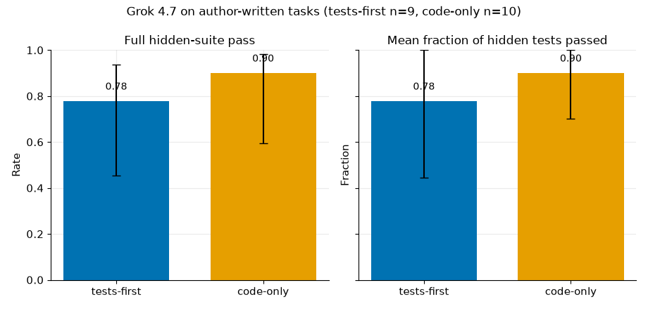
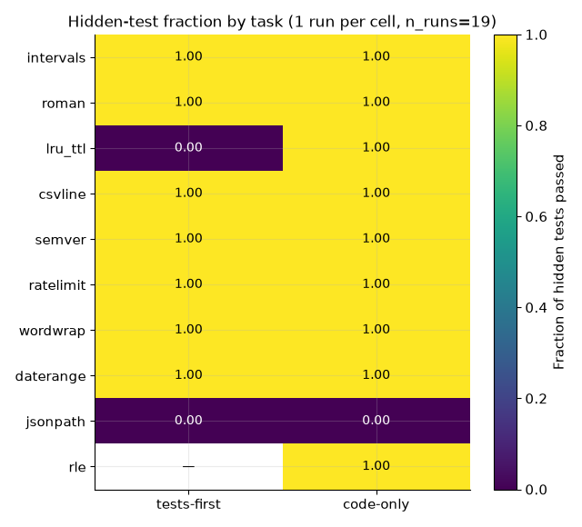
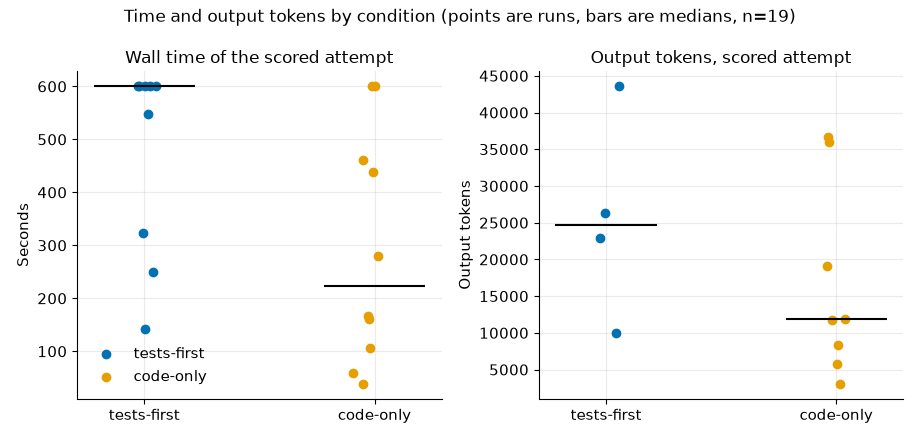

# Do AI-written tests help Grok pass hidden tests?

On 8 Oct 2026, [The Code](https://archive.codenewsletter.ai/2108030810691629403) pointed at a post by Kun Chen ([@kunchenguid](https://x.com/kunchenguid/status/2108030810691629403)). He said that on the DeepSWE eval, banning Claude Sonnet 5.5 (high) from writing tests gave a slightly higher success rate (he marked it not statistically significant) and used significantly less time and fewer tokens. Of the tests the unrestricted arm wrote, he counted 65% unit tests and 35% integration tests, and said neither bucket beat the no-tests arm. A 44-task subset where existing tests were disabled also showed no success-rate change. He did not publish the raw success percentages. The newsletter archive URL itself did not load from this machine (the host resolved to a blocked address). The tweet id in that URL is the post above.

This repo asks a smaller, related question: on 10 original Python tasks with hidden tests, does telling **Grok 4.7** to write pytest tests first raise the hidden-test pass rate, compared with telling it to implement the solution and not write test files?

Telling Grok 4.7 to write its own tests first produced a mean hidden-test fraction 0.111 lower than code-only. The bootstrap 95% CI on that paired difference (-0.33 to 0.00) includes zero. Full passes: tests-first only 0, code-only only 1, both 7, neither 1 (n_pairs=9).

## Results

| | tests-first | code-only |
|---|---:|---:|
| Runs (n) | 9 | 10 |
| Full hidden-suite passes | 7 (77.8%) | 9 (90.0%) |
| Wilson 95% CI, full pass | 45.3% to 93.7% | 59.6% to 98.2% |
| Mean fraction passed | 0.778 | 0.900 |
| Bootstrap 95% CI, mean fraction | 0.44 to 1.00 | 0.70 to 1.00 |
| Median wall time (s) | 600.3 | 222.8 |
| Median output tokens | 24,640 | 11,834 |
| Median cache-read tokens | 235,712 | 77,696 |
| Median CLI total tokens | 318,996 | 137,226 |
| Sum of CLI-reported cost (USD) | 0.532 | 0.628 |
| Median turns | 9.0 | 4.0 |
| Timeouts | 5 | 2 |
| Wrote a test file | 8 | 0 |
| Ran a check command | 4 | 8 |
| Peeked at the repo | 0 | 0 |

Mean fraction CIs are percentile bootstraps of the run-level fractions (10,000 resamples, seed 0). Full-pass CIs are Wilson intervals. Cost is the sum of `total_cost_usd` reported by the Grok CLI, including retries when a retry happened. It is the CLI's figure for these calls, not a separate price-list estimate. Token medians use the scored attempt. CLI total tokens are input + cache-read + output, as the CLI defines `total_tokens`. Output tokens include reasoning tokens. A run with no usage block is left out of the token and cost medians; the `n` inside `summary.json` for those fields says how many runs contributed.

### Per task

| Task | tests-first fraction | code-only fraction | tests-first full | code-only full |
|---|---:|---:|---|---|
| csvline r1 | 1.000 | 1.000 | yes | yes |
| daterange r1 | 1.000 | 1.000 | yes | yes |
| intervals r1 | 1.000 | 1.000 | yes | yes |
| jsonpath r1 | 0.000 | 0.000 | no | no |
| lru_ttl r1 | 0.000 | 1.000 | no | yes |
| ratelimit r1 | 1.000 | 1.000 | yes | yes |
| roman r1 | 1.000 | 1.000 | yes | yes |
| semver r1 | 1.000 | 1.000 | yes | yes |
| wordwrap r1 | 1.000 | 1.000 | yes | yes |







### Tests the agent wrote

Condition tests-first was told to write `test_solution.py`, run it, then implement. Those tests were copied next to the reference solution (not next to the agent's solution) and run.

| | |
|---|---|
| tests-first runs | 9 |
| runs that wrote at least one test file | 8 |
| AST `test*` functions | 216 |
| tests pytest collected | 920 |
| passed on the reference solution | 912 |
| failed on the reference | 8 |
| errors on the reference | 0 |
| false-failing (failed + errors) | 8 |

| Task | rep | test files | AST tests | collected | passed on reference | false-failing |
|---|---:|---:|---:|---:|---:|---:|
| intervals | 1 | 1 | 33 | 33 | 33 | 0 |
| roman | 1 | 1 | 11 | 163 | 163 | 0 |
| lru_ttl | 1 | 1 | 45 | 77 | 76 | 1 |
| semver | 1 | 1 | 21 | 180 | 180 | 0 |
| csvline | 1 | 1 | 16 | 185 | 185 | 0 |
| ratelimit | 1 | 1 | 37 | 73 | 72 | 1 |
| wordwrap | 1 | 1 | 15 | 108 | 104 | 4 |
| daterange | 1 | 1 | 38 | 101 | 99 | 2 |
| jsonpath | 1 | 0 | 0 | 0 | 0 | 0 |

Code-only was told not to write test files. It wrote a test file in 0 of 10 runs. A session-log scan marked a check command (python or pytest) in 8 of 10 code-only runs and 4 of 9 tests-first runs. If the session log could not be read, that run is not counted as a check. See `summary.json` field `n_missing_session_scan`.

## Setup

- Date of the runs: 2026-10-10T16:10:57Z.
- Model flag: `grok-4.7`. CLI: grok 1.0.50 (c58f321264ba).
- Python: 3.13.5 (main, Aug 10 2026, 12:06:59) [GCC 14.2.0].
- Machine: Linux grok-bot-vm-161557313 6.12.94+ #1 SMP PREEMPT_DYNAMIC Tue Oct  6 06:02:30 UTC 2026 x86_64 GNU/Linux. CPU only.
- Solver flags: `--always-approve --output-format json --cwd <fresh dir> -m grok-4.7 --no-subagents --disable-web-search`. Subagents are off so a run cannot fan out past the two-at-a-time cap (other experiments share the plan quota). Web search is off so the comparison is about tests versus no tests on the spec in front of the model. Timeout 600 seconds, one retry if the process fails and the required module is missing.
- Hidden tests per task (all passed on the reference solution before any solver run): intervals 16, roman 20, lru_ttl 11, csvline 19, semver 21, ratelimit 10, wordwrap 19, daterange 14, jsonpath 18, rle 22.
- Work directory for each run: `/tmp/ai-written-tests-work/<condition>/<task>-r<k>/`, containing only `spec.md`. Scoring copies the solution into a different directory and adds the hidden tests there.

## Caveats

- Ten small tasks, written by the same person who wrote the hidden tests and the reference solutions. That is not DeepSWE, not a sample of GitHub issues, and not a test of Claude. n is the number of runs in the table above. The intervals are wide.
- The specs state the behaviour, including the rules that make the tricky cases determined (touching closed intervals, canonical Roman numerals, TTL expiry, SemVer precedence, and so on). They do not list the hidden cases one by one.
- The solver is a full coding agent. The prompt tells it to stay in the work directory. It can still read other paths. Hidden tests and reference solutions are not in the work directory. Runs that touched the repo path are counted in the table (`Peeked at the repo`) and are not dropped, because dropping them would hide the failure mode.
- A full pass means every hidden test passed. The fraction counts collected tests. If pytest could not collect the suite, the fraction is 0 and the denominator used in the mean is the reference count only for that zero; `per_task.csv` has the collected and expected counts.
- Agent-written tests that error on the reference (import errors, bad fixtures) are counted as false-failing together with assertion failures. `summary.json` splits failed and errors.
- CLI cost includes the large Grok Code system prompt, not just the task text. Do not read it as the cost of the spec alone.
- One repetition was the plan, with a second only if the first finished with time to spare. `summary.json` field `reps` is what actually ran.

## Reproduce

```bash
python3 -m venv .venv
.venv/bin/pip install -r requirements.txt
python3 -m venv /tmp/ai-written-tests-pytest
/tmp/ai-written-tests-pytest/bin/pip install pytest==9.1.1
.venv/bin/python -m unittest harness.test_harness
.venv/bin/python harness/run.py --reps 1
.venv/bin/python harness/analyze.py
.venv/bin/python harness/charts.py
.venv/bin/python harness/report.py
```

`harness/run.py` skips task/condition/rep rows already marked `scored` in `results/runs.jsonl`. Raw CLI JSON is under `results/raw/`. Solution trees are under `results/solutions/`.
